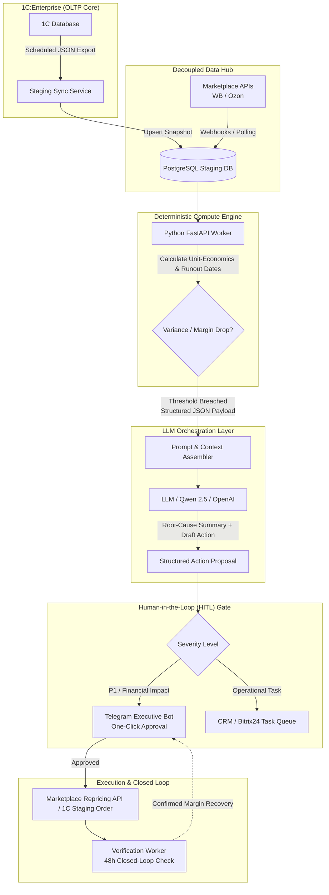

# 1C-PostgreSQL-LLM Gate Pattern

Production architectural pattern for integrating **1C:Enterprise (1С:Предприятие / ERP / КА / УТ)** with external LLM reasoning engines and operational workflows (Telegram, CRM).

---

## 1. High-Level Architecture

---

## 2. Core Architectural Principles

### 1. Isolated Staging (Protecting 1C Core)
- **Problem:** Running analytical joins, vector searches, or frequent API polling on a live 1C Microsoft SQL/Postgres cluster risks table locks, schema cache invalidations, and license violations.
- **Solution:** 1C publishes lightweight daily or hourly incremental JSON snapshots (SKU balances, cost-of-goods, reserved quantities) via HTTP/REST into an external **PostgreSQL Staging DB**.
- The analytics and LLM layer **never connects directly to the 1C primary cluster**.

### 2. Deterministic Math Guardrail (No LLM Hallucinations on Numbers)
- **Rule:** Large Language Models are strictly prohibited from performing arithmetic calculations (e.g., unit margin, commission tiers, runout velocity).
- **Implementation:**
  - Python / SQL code computes precise numbers (e.g. `Margin = 4.1%`, `Loss = 142,000 RUB`, `Days_to_OOS = 6.2`).
  - The LLM receives pre-calculated metrics and serves solely as a **Root-Cause Reasoner and Executive Synthesizer**: explaining *why* the variance occurred and drafting actionable next steps.

### 3. Human-in-the-Loop (HITL) Guardrail
- Automated price changes and purchase orders are routed through an approval gate:
  - **C-Level Telegram Bot:** One-Click `[Approve]` / `[Reject]` for critical financial threshold changes.
  - **CRM Tasks (Bitrix24):** Structured task cards with checklists for operational personnel (e.g. warehouse audits, logistics rerouting).

### 4. Closed-Loop Verification (48h Check)
- Any executed action schedules an automated verification job.
- After 48 hours, the worker verifies that the market price is updated, stock velocity is stabilized, and margin has returned above the target threshold.
