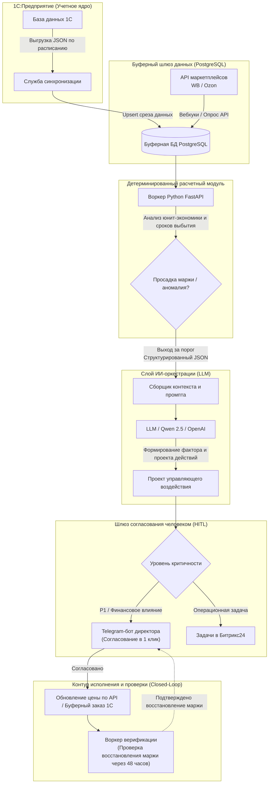

# Архитектурный паттерн: Шлюз 1C-PostgreSQL-LLM

Промышленный архитектурный паттерн интеграции **1С:Предприятия (1С:Предприятие / ERP / КА / УТ)** с внешними аналитическими движками на базе больших языковых моделей (LLM) и оперативными рабочими процессами (Telegram, CRM).

---

## 1. Архитектура решения

---

## 2. Ключевые архитектурные принципы

### 1. Изолированный буфер (Защита контура 1С)
- **Проблема:** Выполнение тяжелых аналитических джойнов (JOIN), векторного поиска или частого опроса API напрямую к боевому кластеру 1С (MS SQL / PostgreSQL) создает риски блокировки таблиц, сброса кэша метаданных и превышения лицензионных лимитов. Боевую 1С нельзя перегружать аналитикой.
- **Решение:** 1С выгружает легковесные ежедневные или почасовые инкрементальные срезы в формате JSON (остатки по SKU, себестоимость, зарезервированные партии) через HTTP/REST во внешнюю **буферную БД (PostgreSQL Staging DB)**.
- Аналитический модуль и слой LLM **никогда не подключаются напрямую к основному кластеру 1С**.

### 2. Детерминированные математические ограничения (Guardrails: расчеты вне LLM)
- **Правило:** Большим языковым моделям категорически запрещено производить математические и финансовые расчеты (юнит-маржа, тарифные сетки комиссий, скорость выбытия остатков).
- **Реализация:**
  - Детерминированный программный код на Python / SQL рассчитывает точные цифры (например, `Маржа = 4.1%`, `Убыток = 142 000 руб.`, `Дней до OOS = 6.2`).
  - LLM получает уже готовые, верифицированные метрики и выступает исключительно в роли **инструмента факторного анализа первопричин и синтеза управленческих решений**: объясняет, *почему* возникла аномалия или отклонение, и формирует структурированный проект действий для бизнеса.

### 3. Шлюз участия человека (Human-in-the-Loop / HITL)
- Автоматические изменения цен и заказы поставщикам в обязательном порядке маршрутизируются через шлюз согласования:
  - **Telegram-бот для руководства (C-Level):** Согласование в 1 клик (`[Одобрить]` / `[Отклонить]`) при преодолении критических финансовых порогов (P1).
  - **Задачи в CRM (Битрикс24):** Структурированные карточки задач с чек-листами для операционистов (инвентаризация на складе, перенаправление поставок, проверка условий хранения).

### 4. Закрытый цикл верификации (Closed-Loop контроль через 48 часов)
- Любое выполненное управляющее воздействие автоматически планирует отложенную задачу на проверку.
- Через 48 часов фоновый воркер проверяет фактическое устранение аномалии: обновилась ли цена на витрине маркетплейса, нормализовалась ли динамика продаж и вернулась ли маржинальность выше целевого порога.
